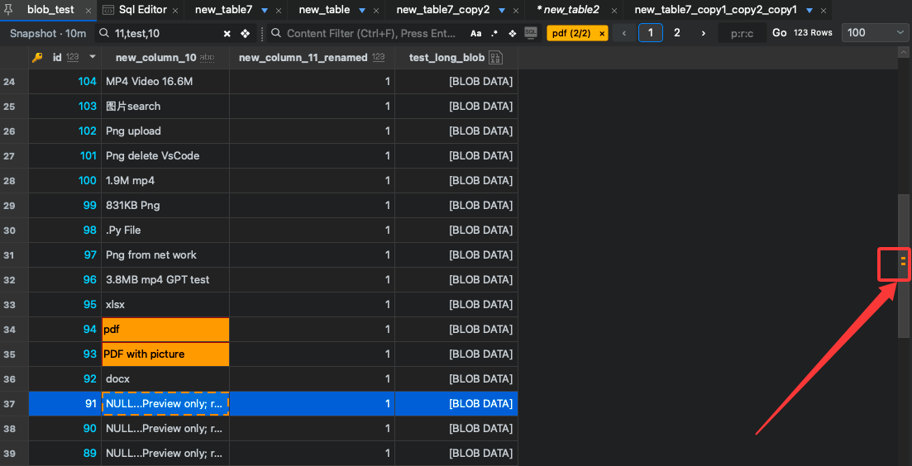
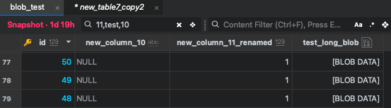
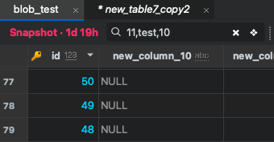

# SqlOtter

**Keep your database work in context.**

SqlOtter is a desktop database workspace for writing SQL, exploring tables, and working with data. It brings object navigation, table tools, SQL editing, saved workspaces, and export into one workflow.

This is the public product and feedback repository.

**Launch status:** the public website, installer downloads and account service are being prepared. This repository currently provides a product preview and workflow guides. Public installation and trial instructions will be added when those services are available.

## Start with a real task

The guides below explain a small task using synthetic data. If you already have an evaluation build, use a local or test database. Otherwise, read the examples and share which workflow you would like to try at launch.

1. Choose one familiar task: locate a table, inspect a query result, or export a small result set.
2. Read the matching guide below. The first SQL example is read-only and uses synthetic data.
3. When working in an available evaluation build, confirm your connection, database and schema before running SQL.
4. Share the workflow you need and any blocker through the repository's Issues page.

| Task | Guide |
| --- | --- |
| Query a small synthetic dataset and inspect the result | [A focused first database task](first-task.md) |
| Find loaded values using highlights and match markers | [Find a value without losing the table context](find-loaded-values.md) |

## Small details that help daily work

### See where loaded matches are

Colored search terms, match counts, and scrollbar markers help you move around the currently loaded table page. This search scope is separate from a query against the entire database.

The image is an existing MySQL example from the product documentation. It illustrates interface controls; available behavior depends on the installed build and database.

### Keep the fields you need in view

Column filtering can reduce visual scanning in a wide table. Comma-separated name keywords and the column layout controls help you focus on relevant fields.

### Review the age of restored views

A restored workspace can contain cached table content. Check the snapshot-age label and refresh when your task needs current database data.

## Database support

SqlOtter documents workflows for multiple engines, including MySQL/MariaDB, PostgreSQL, SQLite, SQL Server, Oracle, MongoDB, and Redis. Feature depth and availability vary by engine and release. A public capability reference and production download entry will be linked here at launch.

Choose a download that is actually offered for your platform; the presence of a database family in the documentation does not imply that every feature or installer is available everywhere.

## Feedback and support

- [Report a bug or suggest a workflow improvement](https://github.com/superadmini/SqlOtter/issues).
- Public account and policy pages will be linked when the website is deployed. Keep account, purchase and confidential questions out of public issues.

Useful feedback includes your OS/architecture, app version/build, database engine/version, intended task, and the step that blocked you. Public issues must not contain credentials, database connection strings, customer records, or payment information. A sanitized example is enough.

The guides use synthetic data and were drafted with AI assistance against the product documentation. They do not constitute a benchmark, a product acceptance result, or a claim about another database client's performance.
