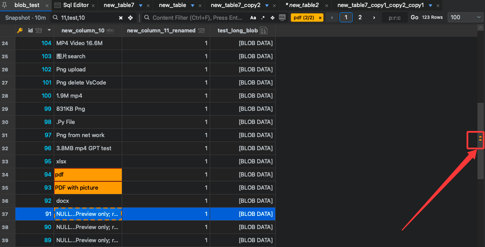

# Find a loaded value without losing the table context

You have opened a table and need to inspect several occurrences of a value. Scrolling row by row makes it easy to lose your place. SqlOtter's table highlights bring keyword tags, match counts, and scrollbar markers into the same view.

## First decide what you are searching

There are three separate questions:

| Question | Suitable starting point |
| --- | --- |
| Which database object has this name? | Object navigation or Go To |
| Which records satisfy a condition? | A database query or supported SQL filter |
| Where does this text occur in the loaded page? | Table content highlights |

This guide covers the last question. Loaded-page highlights do not search every record in your database. If a value is outside the current page, a missing highlight tells you nothing about the rest of the table.

## A focused review workflow

1. Open a safe test table and confirm the selected connection and database.
2. Load the page you want to inspect. Use an SQL condition first if your task needs to narrow database results.
3. Open the content highlight controls and add the value or name fragment you want to inspect.
4. Use the keyword colors and match count to keep your search terms visible.
5. Where the installed build exposes clickable scrollbar markers, choose a marker to move to its match in the loaded content.
6. Read the row identifier and adjacent values before deciding what the match means.

This existing screenshot documents an interface state from a MySQL example. It does not show the synthetic orders in the companion example and does not prove identical behavior in every engine or release.

## Two details that keep the result understandable

**Visible columns affect context.** The implementation described in the feature research excludes hidden columns from highlight inspection. If you cannot see a field you expected to search, check the column layout and relevant guide.

**A restored view may be old.** Review the snapshot-age indicator. Refresh through the normal database path when you need current records; a restored snapshot is not a continuously updated live result.

## Decide whether it saves you effort

Choose a representative test page and locate three known values. Record how often you scroll manually and whether you retain the correct row and target context. Repeat in your usual tool with the same data. Report the observed difference, including cases where the workflow is slower.

[Read the focused first-task guide](first-task.md) or [share a reproducible issue](https://github.com/superadmini/SqlOtter/issues). A link to the public product documentation will be added after the website is available.

*AI-assisted draft grounded in the existing product guide, feature research and screenshot. No performance comparison or new desktop acceptance run was performed for this article.*
